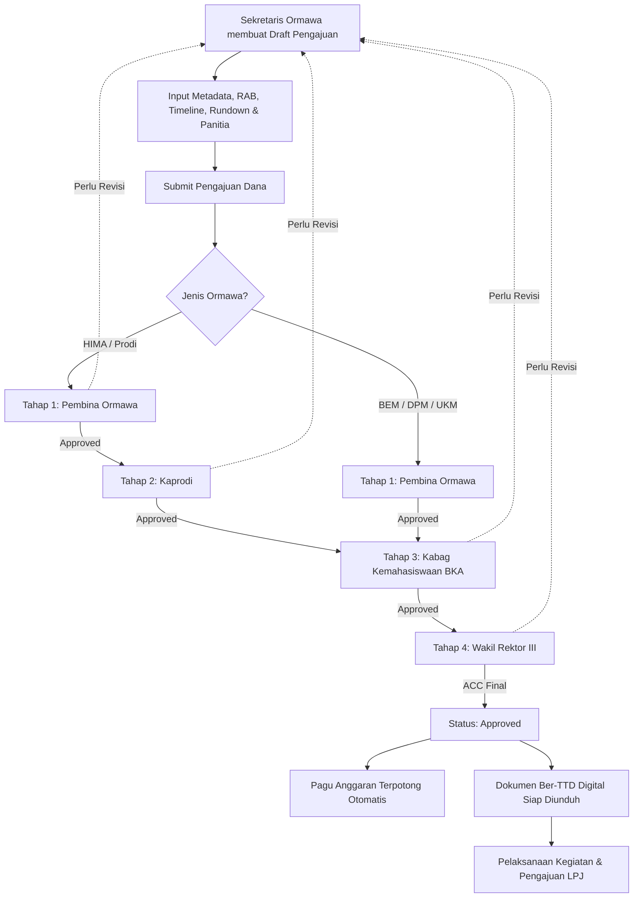

# SIOM (Sistem Informasi Organisasi Mahasiswa)
### Soepraoen Muda 2026/2027 — ITSK RS dr. Soepraoen Malang

[](https://laravel.com)
[](https://livewire.laravel.com)
[](https://php.net)
[](https://pestphp.com)
[](https://tailwindcss.com)
[](LICENSE)

> **SIOM (Sistem Informasi Organisasi Mahasiswa)** adalah platform web terpadu untuk digitalisasi tata kelola administrasi, alur persetujuan proposal (*multi-tier approval workflow*), manajemen pagu anggaran kegiatan, dan pelaporan pertanggungjawaban (LPJ) bagi seluruh Organisasi Mahasiswa (**BEM, DPM, HIMA, dan UKM**) di lingkungan **ITSK RS dr. Soepraoen Malang**.

---

## 📌 Daftar Isi

1. [Fitur Utama](#-fitur-utama)
2. [Alur & Standarisasi Template Dokumen](#-alur--standarisasi-template-dokumen)
3. [Alur Persetujuan (Workflow)](#-alur-persetujuan-workflow)
4. [Struktur Pengguna & Hak Akses (Role Hierarchy)](#-struktur-pengguna--hak-akses-role-hierarchy)
5. [Tech Stack](#-tech-stack)
6. [Prasyarat Sistem](#-prasyarat-sistem)
7. [Panduan Instalasi & Menjalankan Proyek](#-panduan-instalasi--menjalankan-proyek)
8. [Akun Demo & Pengujian](#-akun-demo--pengujian)
9. [Pengujian Otomatis (Testing)](#-pengujian-otomatis-testing)
10. [Struktur Direktori Utama](#-struktur-direktori-utama)
11. [Kontributor & Lisensi](#-kontributor--lisensi)

---

## 🚀 Fitur Utama

- **🏛️ Manajemen Ormawa & Prodi Multi-Tingkat**:
  - Dukungan lengkap ormawa tingkat universitas (**BEM**, **DPM**, **UKM**) dan tingkat fakultas/program studi (**HIMA**).
  - Alur otomatis yang membedakan penandatangan kaprodi untuk HIMA dan universitas untuk BEM/DPM/UKM.
- **📄 Otomasi Dokumen Word (.docx) & PDF**:
  - Mesin *Template Processor* cerdas berbasis `phpoffice/phpword` yang mengisi metadata pengajuan, nomor nota dinas, timeline 4 tahap (perencanaan, persiapan, pelaksanaan, penutupan), tabel RAB dinamis, rundown kegiatan, dan susunan panitia.
  - Injeksi otomatis tanda tangan digital approver dan pimpinan ormawa ke lembar pengesahan.
- **📑 Pemisahan Format Template Administrasi Kampus**:
  - **BEM & DPM**: Format terpisah untuk *Proposal Kegiatan*, *Nota Dinas Pengajuan Dana*, dan *LPJ Realisasi Kegiatan BEM*.
  - **HIMA & UKM**: Format terpadu *Nota Dinas & Proposal Kegiatan Ormawa* serta *LPJ Realisasi Kegiatan Ormawa*.
- **📊 Manajemen Pagu Anggaran & Kas Organisasi**:
  - Pagu anggaran per ormawa per periode aktif.
  - Pemotongan pagu otomatis saat pengajuan disetujui (ACC Final), pelacakan realisasi dana pada LPJ, dan pencatatan buku kas masuk/keluar.
- **🛡️ Alur Persetujuan Bertingkat (*Approval Flow*)**:
  - Review berurutan dengan riwayat verifikasi (*approval logs*), catatan revisi, dan pembubuhan tanda tangan tersimpan.
- **🎨 Campus Portal UI/UX Modern**:
  - Halaman landing interaktif dengan FAQ accordion dan Helpdesk BKA.
  - Portal Autentikasi Split-Card dengan fitur 1-klik pengisian akun demo (*demo role selector*).
  - Antarmuka responsif (tampilan tabel di desktop dan kartu modular di layar mobile).

---

## 📑 Alur & Standarisasi Template Dokumen

SIOM menerapkan sistem template administrasi dinamis yang otomatis memilih file master `.docx` aktif di database sesuai dengan entitas organisasi:

| Kategori Ormawa | Jenis Dokumen | File Master Dokumen (.docx) | Keterangan |
| :--- | :--- | :--- | :--- |
| **BEM & DPM** | Proposal Kegiatan | `FORMAT PROPOSAL KEGIATAN BEM.docx` | Pengesahan: Presma, Ketupel, Kabag BKA, Warek III |
| **BEM & DPM** | Pengajuan Dana | `FORMAT NOTA DINAS PENGAJUAN DANA KEGIATAN BEM.docx` | Nota dinas permohonan dana kegiatan terpisah |
| **BEM & DPM** | LPJ Realisasi | `FORMAT LPJ REALISASI KEGIATAN BEM.docx` | Laporan realisasi anggaran dan kegiatan BEM |
| **HIMA & UKM** | Proposal & Dana | `FORMAT NOTA DINAS & PROPOSAL PENGAJUAN DANA KEGIATAN ORMAWA.docx` | Menggabungkan nota dinas & proposal dalam 1 berkas |
| **HIMA & UKM** | LPJ Realisasi | `FORMAT LPJ REALISASI KEGIATAN ORMAWA.docx` | Laporan pertanggungjawaban ormawa & HIMA |

---

## 🔄 Alur Persetujuan (Workflow)



---

## 👥 Struktur Pengguna & Hak Akses (Role Hierarchy)

| Role | Deskripsi & Wewenang |
| :--- | :--- |
| **Superadmin** | Pengelolaan master data periode akademik, ormawa, prodi, akun pengguna, dan master template dokumen `.docx`. |
| **Sekretaris Ormawa** | Pengurus HIMA/UKM/BEM/DPM yang bertugas membuat draft pengajuan dana, menyusun RAB, mencatat kas, dan mengunggah LPJ. |
| **Pembina Ormawa** | Dosen pembina masing-masing ormawa yang meninjau substansi dan kelayakan kegiatan pada persetujuan tahap 1. |
| **Kaprodi** | Ketua Program Studi yang memverifikasi kegiatan akademik & keselarasan kompetensi untuk pengajuan HIMA. |
| **Kabag Kemahasiswaan** | Kepala Bagian Kemahasiswaan (BKA) yang memverifikasi administrasi, kelayakan anggaran, dan jadwal universitas. |
| **Wakil Rektor III** | Penentu persetujuan akhir (*ACC Final*) atas permohonan dana dan legalitas pelaksanaan kegiatan mahasiswa. |

---

## 🛠️ Tech Stack

- **Framework**: [Laravel 12.x](https://laravel.com/)
- **Full-stack Reactive UI**: [Livewire 3.x](https://livewire.laravel.com/) & [Alpine.js](https://alpinejs.dev/)
- **Document Processing**: [PHPWord](https://github.com/PHPOffice/PHPWord) (OpenXML `.docx` generator)
- **Styling**: [Tailwind CSS](https://tailwindcss.com/) & [Bootstrap Icons](https://icons.getbootstrap.com/)
- **Database**: MySQL 8.x / MariaDB (Didukung SQLite untuk lingkungan unit testing)
- **Test Runner**: [Pest PHP](https://pestphp.com/)

---

## 📋 Prasyarat Sistem

Pastikan perangkat Anda telah terpasang:
- **PHP** `>= 8.2` (dengan ekstensi `zip`, `gd`, `pdo_mysql`, `mbstring`, `fileinfo`)
- **Composer** `>= 2.x`
- **Node.js** `>= 18.x` & **npm**
- **MySQL** `>= 8.0` atau **MariaDB** `>= 10.4`

---

## ⚙️ Panduan Instalasi & Menjalankan Proyek

Ikuti langkah-langkah berikut untuk menjalankan SIOM di lingkungan lokal:

### 1. Clone Repositori
```bash
git clone https://github.com/HadaniZenitha/SIOM2026-2027.git
cd SIOM2026-2027
```

### 2. Pasang Dependensi PHP & JavaScript
```bash
# Pasang paket Composer
composer install

# Pasang paket NPM
npm install
```

### 3. Konfigurasi Lingkungan (.env)
Salin berkas lingkungan dan sesuaikan kredensial basis data:
```bash
cp .env.example .env
php artisan key:generate
```

Buka berkas `.env` dan sesuaikan koneksi database Anda:
```env
DB_CONNECTION=mysql
DB_HOST=127.0.0.1
DB_PORT=3306
DB_DATABASE=siom
DB_USERNAME=root
DB_PASSWORD=
```

### 4. Migrasi & Seeding Basis Data
Jalankan migrasi tabel beserta master data, seeder template dokumen, dan user demo:
```bash
php artisan migrate --seed
php artisan db:seed --class=DocumentTemplateSeeder
php artisan db:seed --class=DemoUserSeeder
```

### 5. Buat Tautan Penyimpanan Berkas (*Storage Link*)
```bash
php artisan storage:link
```

### 6. Build Aset Frontend & Jalankan Server
Buka dua terminal atau gunakan latar belakang:

**Terminal 1 (Build / Watch Aset Frontend):**
```bash
npm run dev
# atau untuk build produksi:
# npm run build
```

**Terminal 2 (Server Laravel):**
```bash
php artisan serve
```

Aplikasi dapat diakses melalui peramban di: **`http://localhost:8000`**

---

## 🔑 Akun Demo & Pengujian

Sistem telah dilengkapi data awal (*demo seeders*) dengan password default: `password`

| Role / Entitas | Email | Password | Keterangan |
| :--- | :--- | :--- | :--- |
| **Superadmin** | `admin@siom.test` | `password` | Master Data & Template Administrasi |
| **Sekretaris HIMA** | `sekretaris@siom.test` | `password` | HIMA S1 Informatika (HIMATIF) |
| **Sekretaris UKM** | `sekretaris.ukm@siom.test` | `password` | UKM Taekwondo |
| **Sekretaris DPM** | `sekretaris.dpm@siom.test` | `password` | Dewan Perwakilan Mahasiswa |
| **Pembina Ormawa** | `pembina@siom.test` | `password` | Dosen Pembina (Tahap 1 Approval) |
| **Kaprodi IF** | `kaprodi@siom.test` | `password` | Kaprodi Informatika (Tahap 2 Approval HIMA) |
| **Kabag BKA** | `kabag@siom.test` | `password` | Biro Kemahasiswaan & Alumni |
| **Wakil Rektor III**| `warek@siom.test` | `password` | Persetujuan Akhir (ACC Final) |

> 💡 **Tip:** Di halaman login (`/login`), Anda dapat menggunakan fitur **1-Klik Demo Login** untuk beralih peran dengan cepat saat pengujian.

---

## 🧪 Pengujian Otomatis (Testing)

Proyek ini dilengkapi dengan unit dan feature tests menggunakan **Pest PHP** untuk memastikan keandalan alur persetujuan, kalkulasi anggaran, dan penjanaan dokumen:

```bash
# Menjalankan seluruh test suite
php artisan test

# Menjalankan pengujian generator dokumen
php artisan test --filter=DocumentGeneratorServiceTest

# Menjalankan pengujian alur persetujuan
php artisan test --filter=ApprovalFlowTest
```

---

## 📂 Struktur Direktori Utama

```text
SIOM2026-2027/
├── app/
│   ├── Http/Middleware/      # Middleware autentikasi & riwayat peramban
│   ├── Livewire/             # Komponen reaktif Livewire (Admin, Sekretaris, Approval, Auth)
│   ├── Models/               # Model Eloquent (Submission, Ormawa, DocumentTemplate, dll)
│   └── Services/             # Layanan inti (DocumentGeneratorService, ApprovalService, CashService)
├── database/
│   ├── migrations/           # Skema tabel relasional
│   └── seeders/              # Data inisialisasi master, template dokumen, dan user demo
├── resources/
│   ├── css/                  # Custom CSS & Tailwind styles
│   └── views/
│       ├── layouts/          # Layout template (App & Guest)
│       └── livewire/         # Template Blade untuk komponen Livewire
├── storage/app/public/
│   └── document-templates/   # Master berkas .docx resmi yang diisi otomatis
└── tests/
    └── Feature/              # Pengujian otomatis skenario aplikasi
```

---

## 📄 Kontributor & Lisensi

Dikembangkan oleh **Tim RnD UPTI & Biro Kemahasiswaan & Alumni (BKA)** — **ITSK RS dr. Soepraoen Malang** untuk memajukan tata kelola organisasi mahasiswa yang transparan, terukur, dan akuntabel.

Proyek ini dilisensikan di bawah [MIT License](LICENSE).

## 🔑 Akun Demo & Pengujian

Sistem telah dilengkapi data awal (*demo seeders*) dengan password default: `password`

| Role / Entitas | Email | Password | Keterangan |
| :--- | :--- | :--- | :--- |
| **Superadmin** | `admin@siom.test` | `password` | Master Data & Template Administrasi |
| **Sekretaris HIMA** | `sekretaris@siom.test` | `password` | HIMA S1 Informatika (HIMATIF) |
| **Sekretaris UKM** | `sekretaris.ukm@siom.test` | `password` | UKM Taekwondo |
| **Sekretaris DPM** | `sekretaris.dpm@siom.test` | `password` | Dewan Perwakilan Mahasiswa |
| **Pembina Ormawa** | `pembina@siom.test` | `password` | Dosen Pembina (Tahap 1 Approval) |
| **Kaprodi IF** | `kaprodi@siom.test` | `password` | Kaprodi Informatika (Tahap 2 Approval HIMA) |
| **Kabag BKA** | `kabag@siom.test` | `password` | Biro Kemahasiswaan & Alumni |
| **Wakil Rektor III**| `warek@siom.test` | `password` | Persetujuan Akhir (ACC Final) |

> 💡 **Tip:** Di halaman login (`/login`), Anda dapat menggunakan fitur **1-Klik Demo Login** untuk beralih peran dengan cepat saat pengujian.

---

## 🧪 Pengujian Otomatis (Testing)

Proyek ini dilengkapi dengan unit dan feature tests menggunakan **Pest PHP** untuk memastikan keandalan alur persetujuan, kalkulasi anggaran, dan penjanaan dokumen:

```bash
# Menjalankan seluruh test suite
php artisan test

# Menjalankan pengujian generator dokumen
php artisan test --filter=DocumentGeneratorServiceTest

# Menjalankan pengujian alur persetujuan
php artisan test --filter=ApprovalFlowTest
```

---

## 📂 Struktur Direktori Utama

```text
SIOM2026-2027/
├── app/
│   ├── Http/Middleware/      # Middleware autentikasi & riwayat peramban
│   ├── Livewire/             # Komponen reaktif Livewire (Admin, Sekretaris, Approval, Auth)
│   ├── Models/               # Model Eloquent (Submission, Ormawa, DocumentTemplate, dll)
│   └── Services/             # Layanan inti (DocumentGeneratorService, ApprovalService, CashService)
├── database/
│   ├── migrations/           # Skema tabel relasional
│   └── seeders/              # Data inisialisasi master, template dokumen, dan user demo
├── resources/
│   ├── css/                  # Custom CSS & Tailwind styles
│   └── views/
│       ├── layouts/          # Layout template (App & Guest)
│       └── livewire/         # Template Blade untuk komponen Livewire
├── storage/app/public/
│   └── document-templates/   # Master berkas .docx resmi yang diisi otomatis
└── tests/
    └── Feature/              # Pengujian otomatis skenario aplikasi
```

---

## 📄 Kontributor & Lisensi

Dikembangkan oleh **SIOM** — **ITSK RS dr. Soepraoen Malang** untuk memajukan tata kelola organisasi mahasiswa yang transparan, terukur, dan akuntabel.

Proyek ini dilisensikan di bawah [MIT License](LICENSE).

